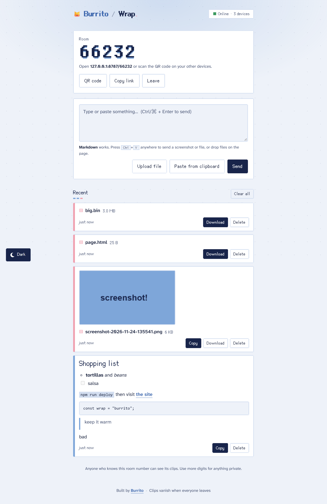
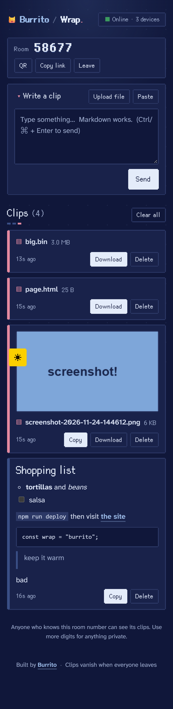

# 🌯 BurritoWrap

A cross-device online clipboard at **https://wrap.burrito.rip**.
Pick a room number, paste on one device, copy on another.
Text supports Markdown, and you can send files and screenshots (press Ctrl+V, or drag and drop).

<p>
  
  
</p>

## How it works

```
 Phone ──┐                         ┌── Laptop
         │   wss:// (stays open)   │
         └──►  Cloudflare Worker ◄─┘
              wrap.burrito.rip
                    │
              Durable Object "Room"
              (one per room number)
```

- **A room is a 4-digit number**, such as `1234`. Every device that opens `wrap.burrito.rip/1234` joins the same room.
- **One Worker** serves the webpage (`public/`) and handles the live connections (`/ws/1234`).
- **One Durable Object per room** keeps each device's WebSocket open and relays new clips to the others instantly.
  It keeps the last 20 clips while the room is in use.
- **Files** are uploaded over plain HTTP (`POST /api/rooms/1234/files`) and stored inside the room in 128 KB pieces, so there's no extra storage service to set up.
  Each file can be up to 10 MB, and each room can hold up to 50 MB. PNG, JPEG, GIF and WebP images get a preview; every other file type is only offered as a download, so an uploaded web page can never run inside the site.
- **Markdown** is turned into HTML in the browser by [marked](https://github.com/markedjs/marked), then cleaned by [DOMPurify](https://github.com/cure53/DOMPurify) so nobody can slip scripts into a room. Images linking to other websites are blocked, because loading them would reveal your IP address to whoever posted them.
- **Rooms destroy themselves.** When the last device leaves, the room waits 60 seconds (in case a phone just locked its screen), then deletes itself and every clip in it.
  Change the wait with `EMPTY_GRACE_SECONDS` in `wrangler.toml`. In a room that stays busy, clips older than 24 hours are also dropped.
- **Rate limiting.** Short numbers are easy to guess, so one visitor can try at most 30 rooms a minute.
  Anyone who knows a room number can still read that room's clips, so press **Destroy** when you're done with anything private.

## Using it

1. Open wrap.burrito.rip. Type any room number and select **Enter room**, or select **Give me a random room** to get an unused 4-digit number.
2. On your other devices, open `wrap.burrito.rip/<number>`, type the same number, or scan the QR code.
3. Select **Write a clip**, type or paste text, and press **Enter** (or select **Send**). Use **Shift+Enter** for a new line. On phones, Enter adds a new line and the **Send** button sends. It appears on every device in the room, formatted as Markdown. Select **Copy** on a clip to put the original text on that device's clipboard.
4. To send a screenshot or file, press **Ctrl+V** anywhere in the room, drag files onto the page, or select **Upload file**. Images can be copied straight back to the clipboard; other files have a **Download** button.

The page remembers your room. Select **Leave** to forget it on that device.
Select **Destroy** to delete the room and everything in it straight away, on every device. Everyone in the room watches the whole page get rolled up like a burrito, then lands back on the home page.
The button in the bottom-left corner switches between light and dark mode.

## Deploying (one-time setup)

You need [Node.js](https://nodejs.org) (version 18 or newer) on your computer.

```bash
npm install
```

```bash
npx wrangler login
```

```bash
npm run deploy
```

`wrangler login` opens a browser window so you can sign in to your Cloudflare account.
Because `burrito.rip` is on that account, deploying creates `wrap.burrito.rip` for you,
including its DNS record and HTTPS certificate. There's nothing to set up in the dashboard.
Everything fits in Cloudflare's free plan.

To deploy again after changing code, run `npm run deploy` again.

## Local development

```bash
npm run dev
```

Then open http://localhost:8787. Use two browser windows to act as two devices.
Opening `public/index.html` directly from disk won't work: the page needs the dev server.

## Files

| Path | What it is |
|---|---|
| `wrangler.toml` | Cloudflare config: the domain route, static assets, Durable Object, rate limit |
| `src/worker.js` | The server: routes requests and runs the `Room` relay |
| `public/index.html`, `style.css` | The webpage, styled after [burrito.rip](https://burrito.rip) |
| `public/app.js` | Browser logic: room numbers, WebSocket and reconnecting, theme toggle |
| `public/vendor/qrcode.js` | QR code generator ([qrcode-generator](https://github.com/kazuhikoarase/qrcode-generator), MIT) |
| `public/vendor/marked.js` | Markdown parser ([marked](https://github.com/markedjs/marked) 15.0.12, MIT) |
| `public/vendor/purify.js` | HTML sanitizer ([DOMPurify](https://github.com/cure53/DOMPurify) 3.2.6, Apache-2.0 / MPL-2.0) |
