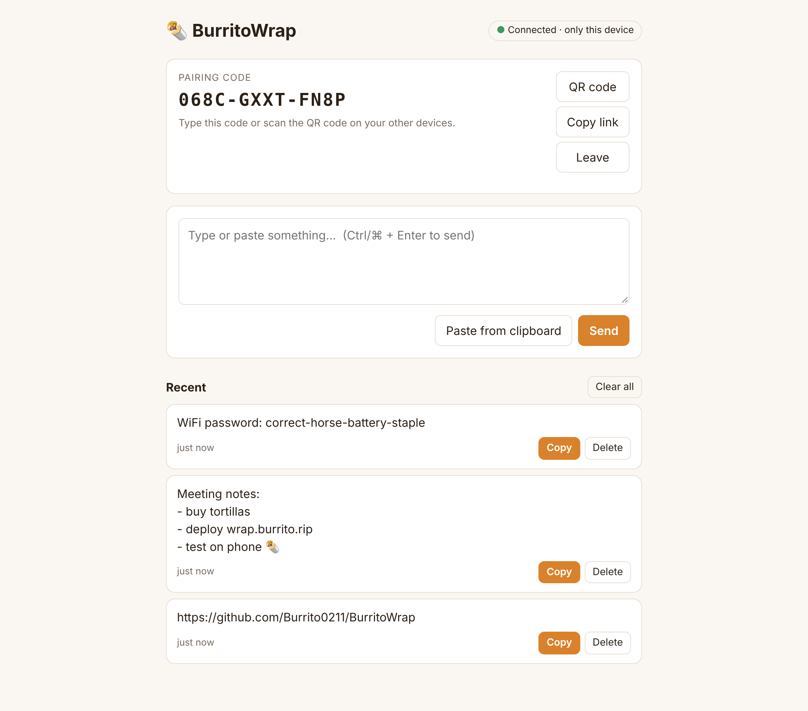
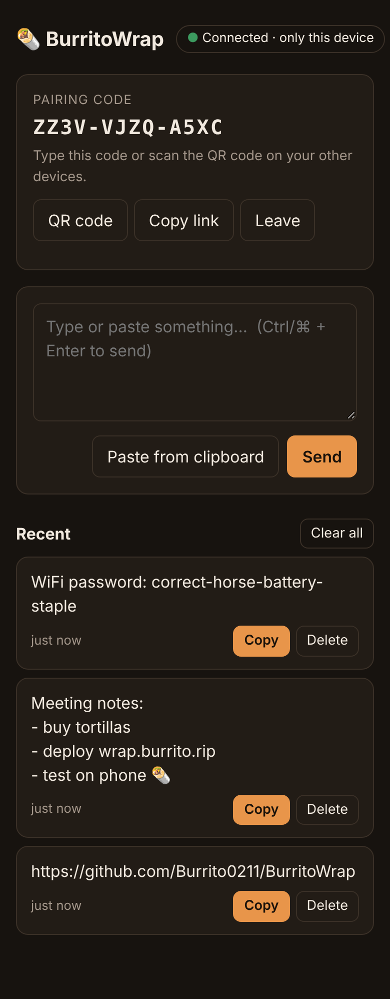

# 🌯 BurritoWrap

A cross-device online clipboard at **https://wrap.burrito.rip**.
Copy on one device and paste on another. Clips are end-to-end encrypted in the browser.

<p>
  
  
</p>

## How it works

```
 Phone ──┐                         ┌── Laptop
         │   wss:// (stays open)   │
         └──►  Cloudflare Worker ◄─┘
              wrap.burrito.rip
                    │
              Durable Object "Room"
              (one per pairing code)
```

- **One Worker** serves the webpage (`public/`) and handles live connections (`/ws/<room>`).
- **One Durable Object per room** keeps each device's WebSocket open and relays new clips to the others instantly.
  It keeps the last 20 clips for 24 hours, and wipes a room after a day of no activity.
- **End-to-end encryption.** The pairing code (`XXXX-XXXX-XXXX`) never leaves the browser.
  The browser derives two things from it:
  - `SHA-256(code)` → the **room id**, sent to the server to group devices
  - `PBKDF2(code)` → an **AES-GCM key**, which encrypts clips before they are sent

  Cloudflare only ever sees the room id and scrambled data.

## Using it

1. Open wrap.burrito.rip and select **Create a new clipboard**.
2. On another device, type the pairing code or scan the QR code. The link carries the code after `#`, which browsers never send to the server.
3. Type or paste text and select **Send**. It shows up on every device in the room. Select **Copy** on a clip to put it on that device's clipboard.

The page remembers your room. Select **Leave** to forget it on that device.

## Deploying (one-time setup)

You need [Node.js](https://nodejs.org) (version 18 or newer) on your computer.

```bash
npm install
```

```bash
npx wrangler login
```

```bash
npm run deploy
```

`wrangler login` opens a browser window so you can sign in to your Cloudflare account.
Because `burrito.rip` is on that account, deploying creates `wrap.burrito.rip` for you,
including its DNS record and HTTPS certificate. There's nothing to set up in the dashboard.
Everything fits in Cloudflare's free plan.

To deploy again after changing code, run `npm run deploy` again.

## Local development

```bash
npm run dev
```

Then open http://localhost:8787. Use two browser windows to act as two devices.

## Files

| Path | What it is |
|---|---|
| `wrangler.toml` | Cloudflare config: the domain route, static assets, Durable Object |
| `src/worker.js` | The server: routes requests and runs the `Room` relay |
| `public/index.html`, `style.css` | The webpage |
| `public/app.js` | Browser logic: pairing, encryption, WebSocket and reconnecting |
| `public/vendor/qrcode.js` | QR code generator ([qrcode-generator](https://github.com/kazuhikoarase/qrcode-generator), MIT) |
